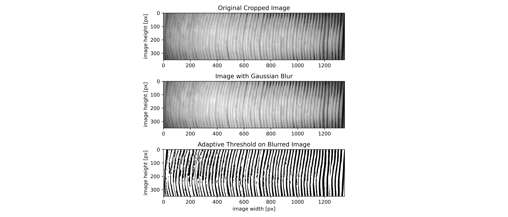
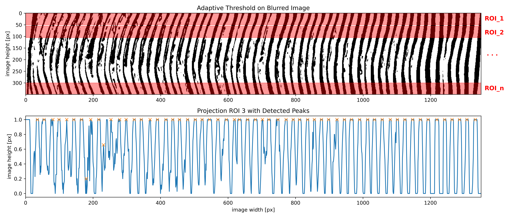

# Edge Detection Prototype: Counting Stacked Products

My solution for the **OPTIMA Edge Detection Challenge** at the **IDS Hackathon 2025**.

**Task:** count stacked, thin products in a single grayscale camera image of a packaging line. The items overlap, are printed, and are unevenly lit, so their edges are hard to tell apart.



## Approach

I used classical computer vision and signal processing, with no training data needed:

1. **Pre-processing:** crop the region of interest and apply an *anisotropic* Gaussian blur (kernel `1×13`). This smooths the printed text along the products while keeping the edges between neighbouring products sharp.
2. **Edge extraction:** adaptive mean thresholding (`cv2.adaptiveThreshold`, block size 31) turns the image into a binary edge map that copes with uneven lighting.
3. **Horizontal ROIs:** the image is split into horizontal stripes. Four layouts were tested: 5×70, 7×50, 10×35 and 14×25 px.
4. **Projection:** for each stripe, the edge pixels are summed column by column. This gives a 1-D signal with one peak per product edge.
5. **Peak detection:** `scipy.signal.find_peaks` counts the peaks per stripe.
6. **Robust count:** the mean, standard deviation and median across all stripes give the final count and a measure of confidence.

With the 10×35 layout, all stripes agreed closely: **mean 60.0 peaks, standard deviation 1.0**.



## Repository structure

```
code/
├── base_analysis.ipynb      # full pipeline: blur → threshold → ROIs → projections → peak statistics
├── peak_analysis.ipynb      # peak detection on the exported projections (scipy)
└── old_analysis_ids.ipynb   # first experiments (Sobel / Canny / "zero plain" counting)
processing_data/
├── projections/             # exported projection signals per ROI layout
└── peaks/                   # detected peak positions per ROI
presentation/                # figures used in the hackathon pitch
requirements/                # pinned environments for the notebooks
```

## Running it

```bash
pip install -r requirements/requirements-base-analysis.txt
jupyter lab code/base_analysis.ipynb
```

The raw camera images (`Aufnahmen/`) are not included. The notebooks keep their outputs, so the results are visible without the data.

## Tech stack

Python · OpenCV · NumPy · SciPy · Matplotlib · Jupyter

> [!NOTE]
> The image data and all product-related material belong to OPTIMA and are shown here with their permission. The MIT license covers only my code.
